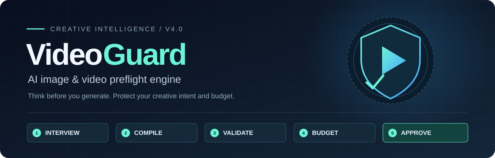
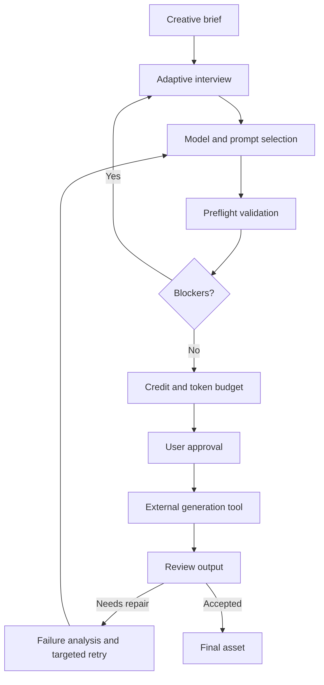

<p align="center"></p>

<p align="center">
  <strong>Interview. Validate. Optimize. Generate.</strong><br>
  Independent preflight for AI image and video workflows.
</p>

<p align="center">
  <a href="SKILL.md"></a>
  
  
  
  <a href="tests/TEST-RESULTS.txt"></a>
</p>

## Why VideoGuard?

AI generation is expensive when the creative brief is unclear. A beautiful prompt can still fail because the reference image, motion requirements, model capabilities or budget do not agree. VideoGuard is a Claude Agent Skill with a lightweight Python preflight engine that helps identify those issues **before** spending generation credits.

It does not generate media or automatically charge your account. It prepares, validates and explains the workflow.

## Methods

| Method | Purpose |
| --- | --- |
| **Creative Detective / Grill Me** | Ask the next highest-impact question, one at a time. |
| **Dynamic Decision Tree** | Adapt questions to the brief and known constraints. |
| **Prompt Linting** | Flag contradictions, overloaded motion and preservation conflicts. |
| **Credit Preflight** | Check budget, retries and official Higgsfield cost-query inputs. |
| **Capability Registry** | Check known model-family constraints; mark unknowns for review. |
| **Nano Banana Prompt Compiler** | Structure image intent, composition, style and constraints. |
| **Style & Camera Registry** | Provide reusable creative vocabulary. |
| **Token Budget Optimization** | Prioritize supplied context estimates without dropping mandatory constraints. |
| **Image-to-Video Handoff** | Inspect supplied metadata and flag incompatible references. |
| **Failure Debugger** | Trace observed failures and identify affected downstream steps. |

## Workflow



## Install

### Claude Code

```bash
git clone https://github.com/icedracon/VideoGuard.git ~/.claude/skills/video-guard
```

Remove or back up an older installation first. Open Claude Code and run `/video-guard`.

### Claude.ai

Download the source archive from **Code → Download ZIP**, extract it, rename the project directory to `video-guard`, and ZIP that directory with `SKILL.md` inside it. Upload it through Claude's custom Skills interface if available on your plan. Python execution and custom Skills availability depend on your environment.

## Quick start

Ask Claude:

> Use VideoGuard in Detective mode. Interview me one question at a time before preparing an image or video prompt. Check model compatibility, references, generation cost, protected elements and acceptance criteria. Ask for approval before any paid generation.

| Mode | Best for |
| --- | --- |
| QUICK | One straightforward image or video prompt |
| DETECTIVE | Unclear, expensive or preservation-critical tasks |
| SENIOR | Multi-shot planning, handoffs, budget and approval gates |

### Run the local engine

Python 3.9 or later. No third-party Python packages required.

```bash
python -m unittest discover -s tests -v
python scripts/guard.py preflight tests/example-brief.json
python scripts/higgsfield_quote.py tests/example-quote.json
```

The example includes unknown cost and capability information; a REVIEW verdict is expected. The second command prints cost-query arguments only. See the [engine reference](references/v3-engine.md) for additional commands.

### Example: architectural video

A client wants a night-time version of an architectural render without changing the building geometry. VideoGuard asks about the reference, desired camera movement, duration, strict preservation constraints and budget. It warns about camera moves that reveal unseen geometry, prepares a prompt, and recommends checking the resulting frames before accepting the clip.

### Example: credit ceiling

Four shots at 20 credits each need 80 credits for one attempt per shot. With one retry per shot the maximum rises to 160 credits. A 100-credit budget leaves only one extra attempt; VideoGuard's budget checker rejects the full retry plan. These are illustrative rates, not provider quotes.

## Supported workflows

Higgsfield / Seedance, Runway, Kling, Veo, GPT Image, Nano Banana, FLUX and other generators through model-specific prompt guidance. Direct generation API integrations are not included. The Higgsfield adapter can prepare a cost-only query; live use requires the official authenticated CLI and consent.

## Documentation

- [Agent skill](SKILL.md)
- [Engine and CLI](references/v3-engine.md)
- [Interview method](references/interview.md)
- [Model guidance](references/models.md)
- [Image planning](references/image.md)
- [Image-to-video handoff](references/handoff.md)
- [Budget and retry strategy](references/cost.md)
- [Evaluation](references/evaluation.md)
- [Upstream inspiration and official sources](references/sources.md)

## Validation & limitations

The original v3.0 package passes 36 local unit tests. The tests cover deterministic rules, not live model performance. Prompt linting is heuristic, image compatibility uses metadata and agent inspection, and token estimates are not provider tokenizer counts. A passing preflight is not a guarantee of success. Prices and capabilities must be confirmed before paid actions. Actual credit savings and Claude/Higgsfield live compatibility have not been measured.

## Credits & references

Independent implementation inspired by adaptive interviewing, model-specific creative prompting and generation preflight practices:

- [Grill Me — RobMitt](https://github.com/RobMitt/grill-me-skill): sequential interview technique.
- [Higgsfield Seedance — hugojsfranca](https://github.com/hugojsfranca/higgsfield-seedance): preflight concept; repository access was unavailable during the prior review.
- [Nano Banana Image Skill — Emily2040](https://github.com/Emily2040/nano-banana-image-skill): model-aware prompt structure.
- [Higgsfield official CLI](https://higgsfield.ai/blog/higgsfield-cli): cost-query integration reference.
- [Claude Agent Skills](https://platform.claude.com/docs/en/agents-and-tools/agent-skills/overview): skill conventions.

No upstream repository code is imported. See [all sources](references/sources.md). VideoGuard is not affiliated with Anthropic, OpenAI, Google, Runway or Higgsfield.

<p align="center"><strong>Think before you generate.</strong><br>Built by <a href="https://github.com/icedracon">icedracon</a>.</p>
